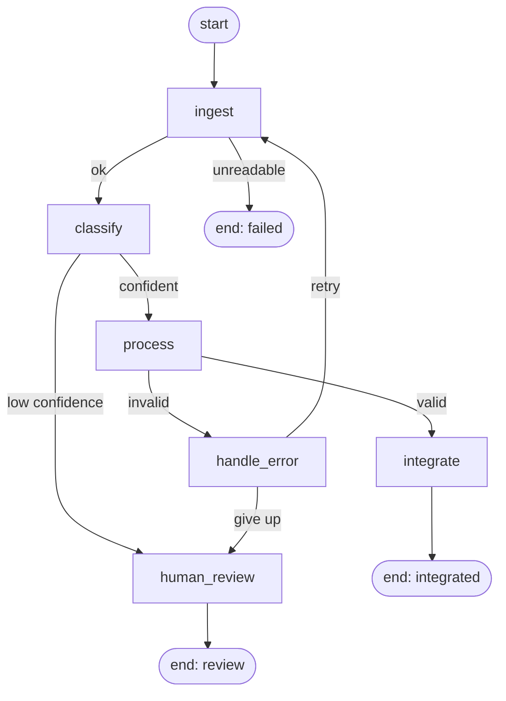

# Architecture

The pipeline is a [LangGraph](https://langchain-ai.github.io/langgraph/) `StateGraph`. Each box
below is a plain Python function that reads the shared state and returns only the keys it changes.



## Shared state

`IntelliDocState` (in `intellidoc/state.py`) is a `TypedDict`:

| Key | Meaning |
|---|---|
| `doc` | path, extracted text, and the current OCR settings |
| `doc_type`, `doc_type_confidence` | classifier result |
| `extracted_data` | the validated fields (or the raw attempt, if validation failed) |
| `validation` | `{passed, issues}` |
| `status` | `pending`, `processing`, `integrated`, `review` or `failed` |
| `errors`, `warnings` | messages shown to the user |
| `retries` | how many times the document has been re-read |
| `metadata` | extraction method, OCR confidence, classifier used, attempt log |
| `settings` | `min_confidence`, `max_retries`, `data_dir`, `use_jev` |

## Nodes

| Node | Job |
|---|---|
| `ingest` | Read the file. Text files directly; PDFs page by page (native text if the page has any, OCR otherwise); images through OCR with optional preprocessing. |
| `classify` | Decide the document type with Jev, or keywords if Jev is off or fails. |
| `process` | Run the extractor for that type, then validate with the Pydantic model. |
| `handle_error` | Decide between retry and escalate. |
| `human_review` | Append the document and its problems to `review_queue.jsonl`. |
| `integrate` | Write to SQLite through an adapter chosen by document type. |

## Routing

Routing lives in `intellidoc/routing.py`, separate from the nodes, so each decision is one small
testable function.

- After ingest: unreadable file ends the run as `failed`.
- After classify: confidence below `--min-confidence` goes to review.
- After process: validation failure goes to `handle_error`.
- After handle_error: retry only if the page was read by OCR **and** retries remain.

## Retries change strategy

Running the same OCR a second time gives the same answer, so a retry always changes something:
preprocessing is switched on and Tesseract's page-segmentation mode moves through 4, 11, 12.
Documents read from native PDF text are never retried because the text was already exact; they go
straight to review. Every attempt (mode, preprocessing, OCR confidence, result) is kept in
`metadata.attempt_log` and shown in the dashboard.

## Integration

`ADAPTERS` in `intellidoc/nodes.py` maps document type to a function that inserts into the right
table. Adding a destination means adding one function and one dictionary entry.

| Table | Used for |
|---|---|
| `documents` | one row per integrated document |
| `identity_documents` | PAN and Aadhaar; the Aadhaar number is stored masked (`XXXX XXXX 0124`) |
| `papers` | research papers |
| `other_documents` | everything else |

## Files

```
intellidoc/
  state.py       shared state and defaults
  ingest.py      file -> text (native text, OCR)
  preprocess.py  image clean-up
  classify.py    Jev and keyword classifiers
  schemas.py     Pydantic models and checks
  extract.py     text -> raw fields
  nodes.py       process, handle_error, human_review, integrate
  routing.py     routing functions
  pipeline.py    graph assembly and streaming runner
  stats.py       reads events.jsonl
  cli.py         command line
  api.py         FastAPI app
  web/index.html dashboard
```
